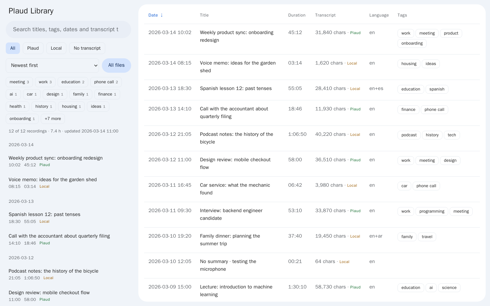
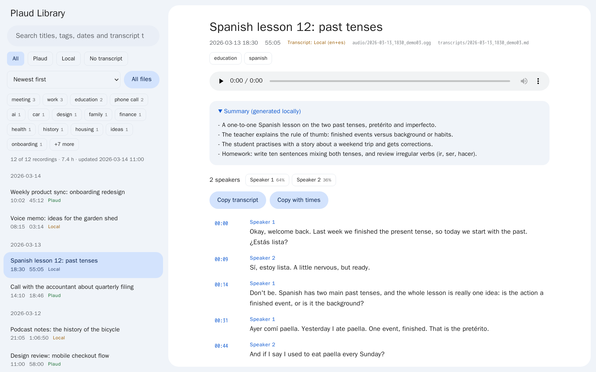
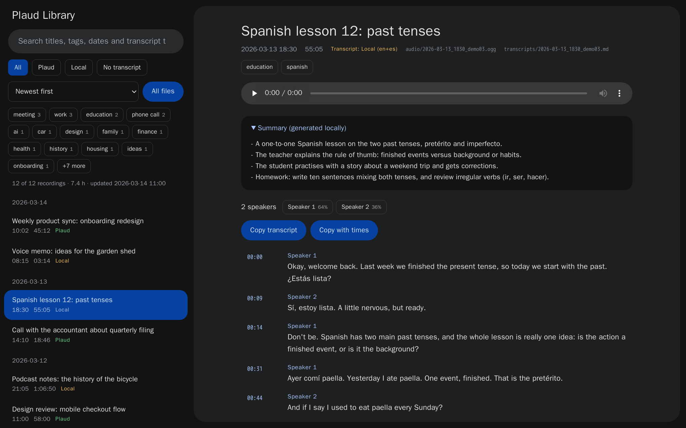

# Plaud transcripts

A private, searchable library of everything you record with a [Plaud](https://plaud.ai)
device. It downloads every recording from your Plaud account, gives each one a transcript,
title, summary, tags and speaker labels, and serves them in a local web page.

Everything except the download runs on your own machine with local models: no recording,
transcript or summary is sent to any AI service.





<details>
<summary>Dark mode</summary>



</details>

The recordings in the screenshots are invented examples.

## What you get

- **Every recording, kept locally.** Audio and transcript are saved side by side under
  `library/`, named by date and time.
- **Transcripts for all of them.** Plaud's own transcript is used when a recording has
  one; the rest are transcribed on your machine with Whisper. Mixed-language recordings
  work: the language is detected for every 30 seconds.
- **Titles, summaries and tags** written by a local LLM for recordings Plaud has not
  summarised.
- **Speaker labels** (`Speaker 1`, `Speaker 2`) on local transcripts (Docker route), like the ones Plaud
  gives its own.
- **A viewer page.** Sort, search across all transcript text, filter by tag or by
  speaker, play from any timestamp, copy a transcript as text. Light and dark mode.
- **An MCP server**, so an AI assistant on the same machine can search the library.
- **Hands-off.** Run it hourly; finished recordings are skipped, so each run only handles
  what is new.

## Quick start

| | Docker (Windows, Linux, any CPU) | macOS (Apple Silicon) |
| --- | --- | --- |
| Needs | Docker | conda (Miniconda or Miniforge), Node.js for the login |
| Engines | `faster-whisper`, `llama.cpp`, `sherpa-onnx` | MLX Whisper, MLX LLM |
| Start | `login.ps1`, then `docker compose up -d --build` | `./run.sh` |
| Hourly runs | built in | `./schedule.sh install` |
| Viewer | <http://127.0.0.1:8765> | `library/index.html` opens by itself |

Details for each are in [Docker](#docker-always-on-pc) and [macOS](#macos) below. The
first run downloads the models once (about 7 GB with Docker); after that it works offline
apart from the calls to Plaud.

## macOS

```
./run.sh
```

That one command:

1. Creates the `plaud_transcripts` conda environment from `environment.yml` (first run only).
2. Logs in to Plaud if there is no saved login: your browser opens, you approve once.
3. Downloads the audio of every recording into `library/audio/`.
4. Saves a transcript for each into `library/transcripts/`. Plaud's own transcript is
   used when the recording has one (it has speaker labels); the rest are transcribed
   on this machine with Whisper (MLX, Apple Silicon).
5. Writes a title and short summary for recordings Plaud has not summarised, with a
   local LLM (MLX).
6. Tags every recording (3 to 5 tags from its title and summary, same local LLM).
   Recordings too short to summarise get a title that says so (`No summary · first words`
   or `No speech`).
7. Builds and opens `library/index.html`, the viewer page shown above.

Run it again any time: finished recordings are skipped, so it only handles new ones.
Ctrl-C is safe.

### Automatic runs

```
./schedule.sh install        # every 60 minutes while the Mac is awake, and at login
./schedule.sh install 30     # another interval, in minutes
./schedule.sh status
./schedule.sh uninstall
```

This installs a per-user launchd job that runs `./run.sh` in the background and logs to
`library/auto.log`. It never opens the browser: if the Plaud login expires you get a
notification to run `./run.sh` once by hand. Only one run happens at a time, so a manual
`./run.sh` during a scheduled run just exits.

## Docker (always-on PC)

Two containers: `plaud-sync` checks Plaud every hour and does all the work on the CPU
with the portable engines (`faster-whisper`, `llama.cpp`, `sherpa-onnx`); `plaud-viewer`
serves the library page. Only Docker Desktop is needed; nothing else is installed on the PC.

```
powershell -ExecutionPolicy Bypass -File .\login.ps1   # once: Plaud login, opens a link
docker compose up -d --build                           # start (and after code changes)
docker logs -f plaud-sync                              # watch a run
```

- Viewer: <http://127.0.0.1:8765>. It has no login, so never forward it to the internet.
- `login.ps1` runs Plaud's login CLI in a throwaway Node container and saves the token in
  `%USERPROFILE%\.plaud`, which `plaud-sync` mounts. When the log says `LOGIN EXPIRED`,
  run it again.
- Models are downloaded once into the `plaud_models` volume (about 7 GB) and survive rebuilds.
- Both containers restart with Docker (`restart: unless-stopped`). Docker Desktop must be set
  to start at sign-in, and the PC must sign in by itself after a reboot.
- Each run is also logged to `library\auto.log`.

Settings go in a `.env` file next to `docker-compose.yml`:

| Variable | Purpose |
| --- | --- |
| `SYNC_INTERVAL` | Seconds between runs (default 3600). |
| `SYNC_ARGS` | Extra `sync.py` options, for example `--limit 3` for a first test. |
| `VIEWER_BIND` | `127.0.0.1` (default, this PC only) or `0.0.0.0` (home network). |
| `VIEWER_PORT` | Viewer port (default 8765). |
| `TZ` | Time zone for recording times (default `Europe/Berlin`). |
| `HF_HUB_OFFLINE=1` | Set once the models are downloaded: no more calls to Hugging Face. |
| `PLAUD_TOKEN_DIR` | Folder with `tokens.json` (default `%USERPROFILE%\.plaud`). |
| `WHISPER_MODEL`, `WHISPER_THREADS`, `WHISPER_DETECT_EVERY`, `DIARIZE` | As in the table below. |

MCP server for an AI assistant on the same PC (the container must be running). Give your
MCP client this command:

```
docker exec -i plaud-sync python mcp_server.py
```

## Windows without Docker

The same pipeline runs natively on Windows with the portable engines. `sync.py` picks them
automatically when it is not on Apple Silicon. Use this or Docker, not both.

Needed once: Miniconda or Miniforge, and Node.js (only for the browser login).

```
powershell -ExecutionPolicy Bypass -File .\run.ps1 --limit 3     # first test
powershell -ExecutionPolicy Bypass -File .\schedule.ps1 install  # then every 60 minutes
```

`run.ps1` creates the conda environment from `environment.portable.yml`. The scheduled
task runs while you are logged on and logs to `library\auto.log`. These two scripts have
not been run on Windows yet.

On a CPU-only PC, transcription is slow. Settings to lighten it:

| Environment variable | Purpose |
| --- | --- |
| `WHISPER_MODEL` | `large-v3-turbo` (default), or `small` / `base` for speed at lower accuracy. |
| `WHISPER_DEVICE`, `WHISPER_COMPUTE` | `auto` by default; `cuda` and `float16` for an NVIDIA GPU. |
| `WHISPER_THREADS` | CPU threads for Whisper (default: library's choice). |
| `WHISPER_DETECT_EVERY` | Check the language on every Nth 30 s section (default 4; 1 is most exact, slower). |
| `WHISPER_VAD=1` | Skip silence: much faster on long quiet recordings, but quiet speech can be lost. |
| `SUMMARY_MODEL` | `<hf repo>:<file>.gguf` or a path to a `.gguf` file. Default is a 7B model (about 5 GB of RAM); pick a 3B one for small machines. |
| `DIARIZE=0` | Turn speaker labels for local transcripts off. |
| `DIARIZE_THRESHOLD` | How different two voices must be to count as two speakers. Higher gives fewer speakers. Default: 0.55 up to 15 minutes, rising to 0.7 for an hour or more. |
| `DIARIZE_MIN_SHARE` | Speakers with less than this share of the talk time are folded into their neighbour (default 0.02). |
| `DIARIZE_THREADS` | CPU threads for speaker labels (default 4). |

Or let the PC only collect: `.\run.ps1 --no-local --no-summary` downloads audio and
Plaud's own transcripts and needs no models.

## Login

The login is Plaud's official OAuth flow, done by Plaud's CLI (`@plaud-ai/cli`, run
through `npx`, never installed globally). It stores a token in `~/.plaud/tokens.json`.
`sync.py` refreshes that token itself when it expires, so there is no header to copy
from the browser. If Plaud ever rejects the saved login, `run.sh` opens the login again
and carries on.

## Options

```
./run.sh --limit 5         # only the 5 newest (good first test)
./run.sh --since 2026-01-01
./run.sh --no-local        # no local Whisper: audio + Plaud's transcripts only
./run.sh --force-local     # transcribe everything locally, ignore Plaud's transcripts
./run.sh --refresh         # re-check Plaud for recordings that were transcribed locally
./run.sh --language ar     # force one Whisper language (default: detected per section)
./run.sh --no-summary      # skip local titles, summaries and tags
./run.sh --model mlx-community/whisper-large-v3-mlx
```

| Environment variable | Purpose |
| --- | --- |
| `PLAUD_LIBRARY` | Where to put the library (default `./library`). |
| `PLAUD_REGION` | Sent as `x-pld-region` if your account needs it. |
| `WHISPER_MODEL`, `WHISPER_LANGUAGE` | Defaults for `--model` / `--language`. |
| `SUMMARY_MODEL` | Default for `--summary-model` (`mlx-community/Qwen2.5-14B-Instruct-4bit`). |
| `NO_OPEN=1` | Do not open the viewer when the run ends. |
| `NO_LOGIN=1` | Never open the browser login (unattended runs); fail with a message instead. |

## Files

Audio and transcript share a name, so they can be matched without the viewer:

```
library/audio/2026-11-09_1213_<name>_<id>.ogg
library/transcripts/2026-11-09_1213_<name>_<id>.md
```

The date and time are the local recording start. `library/data/manifest.json` maps
every Plaud id to its files.

## Languages

Whisper normally decides the language from the first 30 seconds, which goes wrong when
a recording opens with noise or switches language. Here the language is detected for
every 30-second section, and each stretch is transcribed in its own language, so a
recording with Arabic and English parts gets both. The languages found are shown next
to the transcript (for example `ar+en`).

## Speaker labels

Plaud's transcripts come with speaker labels. Local transcripts get the same kind
(`Speaker 1`, `Speaker 2`, numbered in order of first appearance) from `sherpa-onnx`
speaker diarization, which runs on the CPU with two small models (about 30 MB, downloaded
once from the sherpa-onnx GitHub releases, no account). It is part of the portable
environment only (`environment.portable.yml`).

Local transcripts made before this existed are labelled once on the next run, without
transcribing again (`diarize_v` in the manifest records it). On a CPU it takes roughly a
tenth of the recording's length.

The labels are rough. Checked against Plaud's own labels on short recordings: clean
two-person conversations mostly match, but similar voices are sometimes merged into one
speaker and noisy recordings can be split into too many. Long recordings use a stricter
threshold, and speakers with under 2% of the talk time are folded into their neighbour.
Tune with `DIARIZE_THRESHOLD`, or turn it off with `DIARIZE=0`.

## MCP server

`mcp_server.py` lets an AI assistant (any MCP client) explore the library: it is read-only,
works on the local files, and never contacts Plaud.

| Tool | What it does |
| --- | --- |
| `library_overview` | Counts, hours, date range, recordings per month. |
| `list_recordings` | Recordings by date range, title, tag, minimum length. |
| `search_transcripts` | Text search over titles, summaries and transcripts, with timestamps. |
| `get_recording` | One recording's details, summary and file paths. |
| `get_transcript` | The transcript, paged. |

It speaks MCP over stdio. On the Mac the command to start it is `mcp.sh`; most MCP clients
take a config entry like this, with the full path:

```json
{ "mcpServers": { "plaud-library": { "command": "/full/path/to/plaud_transcripts/mcp.sh" } } }
```

## Limits

- Plaud's public API is read-only: transcripts made here cannot be uploaded back into
  the Plaud app. The local viewer is the replacement.
- Speaker labels on local transcripts are rough, and have no names (see Speaker labels).
- The first local transcription downloads the Whisper model (about 1.6 GB); the first
  summary downloads the LLM (about 8 GB on Apple Silicon, about 4.5 GB elsewhere).
- Each machine keeps its own `library/` and its own Plaud login. To move a library, copy
  the whole folder; paths inside it are relative.
- Local titles and summaries are rough: a reference to find things, not a record.
- On noise Whisper can still invent a few words; repeated filler is filtered out.
- `library/` holds private recordings and is git-ignored.
